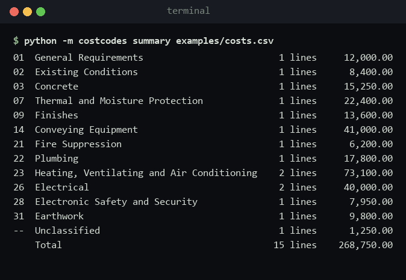

# cost-code-mapper

Sorts free-text invoice and cost lines into CSI MasterFormat divisions (Concrete, Plumbing, Electrical and so on) using keyword rules.



## What it is for

Invoices and pay applications describe work in plain words, but cost reports are organized by MasterFormat, the standard numbered list of construction work categories (Division 03 is Concrete, 22 is Plumbing, 26 is Electrical). Cost engineers and project controllers spend hours labeling lines by hand. This tool proposes a division for every line, says how sure it is, flags the lines a person must review, and totals the money per division.

## Install

```
git clone https://github.com/yassine2med/cost-code-mapper
cd cost-code-mapper
python -m pip install -r requirements.txt pytest
```

## How to use

| I want to | Command |
|---|---|
| Label every row of a cost CSV | `python -m costcodes map examples/costs.csv` |
| Save the labeled rows to a new CSV | `python -m costcodes map examples/costs.csv --out labeled.csv` |
| Total the money per division | `python -m costcodes summary examples/costs.csv` |
| Classify one description | `python -m costcodes lookup "boiler replacement"` |
| Use other column names | add `--column desc --amount cost` to `map` or `summary` |

The CSV needs a description column (default name `description`) and may have an amount column (default `amount`). Confidence is high, medium, low (two divisions tied) or none (no keyword found).

Example with the invented costs in `examples/costs.csv`:

```
python -m costcodes summary examples/costs.csv
```

Output:

```
01  General Requirements                         1 lines     12,000.00
02  Existing Conditions                          1 lines      8,400.00
03  Concrete                                     1 lines     15,250.00
07  Thermal and Moisture Protection              1 lines     22,400.00
09  Finishes                                     1 lines     13,600.00
14  Conveying Equipment                          1 lines     41,000.00
21  Fire Suppression                             1 lines      6,200.00
22  Plumbing                                     1 lines     17,800.00
23  Heating, Ventilating and Air Conditioning    2 lines     73,100.00
26  Electrical                                   2 lines     40,000.00
28  Electronic Safety and Security               1 lines      7,950.00
31  Earthwork                                    1 lines      9,800.00
--  Unclassified                                 1 lines      1,250.00
    Total                                       15 lines    268,750.00
```

`map` on the same file ends with `2 of 15 rows need review` (the unmatched "Miscellaneous items" and a tied excavation and utility trench line).

## How it works

- `rules.py` holds a list of keywords for each division. Multi-word phrases count double.
- A description is lowercased and matched on whole words, with a simple plural ending.
- The division with the highest score wins. A tie is reported as low confidence.
- `summary` adds the amounts per division and puts unclassified lines last.

## Limits

Keyword matching, not machine learning, and the keyword lists are my own, not an official CSI product. It covers 23 common divisions (not 15 to 20, 24, 25, 29, 30, 34 and up). Always review low and none rows. MasterFormat is a CSI trademark; only the division names are used.

MIT license. Yassine Emhamed, 2026.
